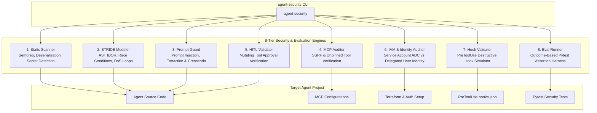

# Agent Security CLI 🛡️

[](https://www.python.org/downloads/)
[](LICENSE)
[]()

Enterprise AI Agent Security, STRIDE Threat Evaluation, and Cognitive Gating CLI.

Provides static secret scanning, AST-based STRIDE architectural threat modeling, Prompt Guard adversarial red-teaming, Model Context Protocol (MCP) server security auditing, Human-In-The-Loop (HITL) mutating tool verification, IAM & Delegated Agent Identity auditing, dynamic `PreToolUse` lifecycle hook validation, outcome-based security test execution, and Google Cloud Storage (GCS) compliance reporting.

---

## 🏛 Architecture & 8-Tier Security Engine



---

## 🚀 Installation & Quickstart

```bash
# 1. Clone this repository
git clone https://github.com/RaviManjunatha/agent-security-cli.git
cd agent-security-cli

# 2. Install in editable mode
pip install -e .

# 3. Verify installation
agent-security --help
# Or alias:
agent-sec info
```

---

## 📖 Command Reference

### 1. `agent-security info`
Displays active toolchain capabilities and security inspection modules.
```bash
agent-security info
```

### 2. `agent-security scan <path>`
Scans agent source code for hardcoded API keys, RSA certificates, `os.system` calls, insecure deserialization (`pickle.loads`, `yaml.unsafe_load`), and unsafe `shell=True` subprocesses.
```bash
agent-security scan /path/to/my-agent
# Output findings as JSON
agent-security scan /path/to/my-agent --json-output
```

### 3. `agent-security threat-model <path>`
Performs automated AST-based STRIDE threat modeling against agent tools and state definitions (flags IDOR tool arguments, in-memory races, unbounded while loops, and unauthenticated privileged functions).
```bash
agent-security threat-model /path/to/my-agent
# Export to markdown file
agent-security threat-model /path/to/my-agent -o threat_model.md
```

### 4. `agent-security prompt-guard <path>`
Simulates adversarial direct/indirect prompt injection, system prompt extraction, and crescendo drift attacks against agent instructions.
```bash
agent-security prompt-guard /path/to/my-agent
```

### 5. `agent-security mcp-check <path>`
Audits Model Context Protocol (MCP) server configurations for cleartext HTTP transport, loopback/metadata SSRF endpoints (`169.254.169.254`), and unpinned package executions (`npx -y`).
```bash
agent-security mcp-check /path/to/my-agent
```

### 6. `agent-security hitl-check <path>`
Verifies that high-impact mutating tools (`delete`, `refund`, `payout`, `transfer`, `grant`) have explicit Human-In-The-Loop approval gates.
```bash
agent-security hitl-check /path/to/my-agent
```

### 7. `agent-security iam-check <path>`
Audits authentication and authorization architecture to verify if the agent uses **Application Default Credentials (ADC)** vs. **Delegated End-User Identity**, and detects Ambient Authority IDOR vulnerabilities in tool parameter signatures.
```bash
agent-security iam-check /path/to/my-agent
```

### 8. `agent-security hook-check <path>`
Simulates dangerous test vectors (`rm -rf /`, `mkfs.ext4`, fork bombs) against `PreToolUse` lifecycle hooks to verify fail-closed gating.
```bash
agent-security hook-check /path/to/my-agent
```

### 9. `agent-security test <path>`
Discovers and executes outcome-based pytest security boundary test suites.
```bash
agent-security test /path/to/my-agent
# Target specific test file
agent-security test /path/to/my-agent -f tests/test_agent.py
```

### 10. `agent-security audit <path>`
Executes the **full unified security pipeline end-to-end** and exports compliance reports to Google Cloud Storage:
```bash
agent-security audit /path/to/my-agent \
  --to-gcs gs://my-security-reports-bucket/audit/ \
  -o AGENT_SECURITY_AUDIT_REPORT.md
```

---

## 🧪 Running Tests

```bash
pytest tests/ -v
```

---

## 👥 Authors & Contributors

* **Ravi Manjunatha** — [@RaviManjunatha](https://github.com/RaviManjunatha)
* **Krishna Gupta** — [@RootedRover](https://github.com/RootedRover)

---

## 📜 License & Security
Licensed under the [Apache License, Version 2.0](LICENSE).

Eligibility for the [Google Open Source Software Vulnerability Rewards Program](https://bughunters.google.com/open-source-security) is determined by the [Google Open Source Software Vulnerability Reward Program Rules](https://bughunters.google.com/about/rules/open-source/google-open-source-software-vulnerability-reward-program-rules).
